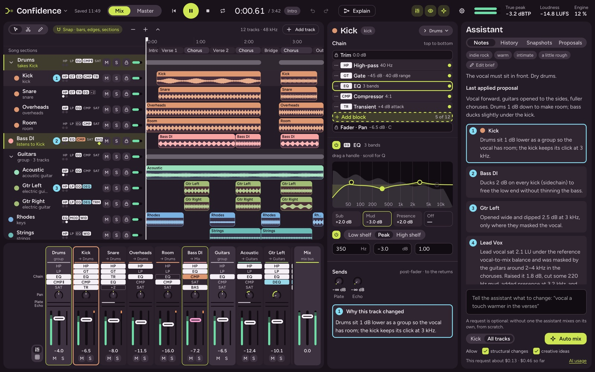
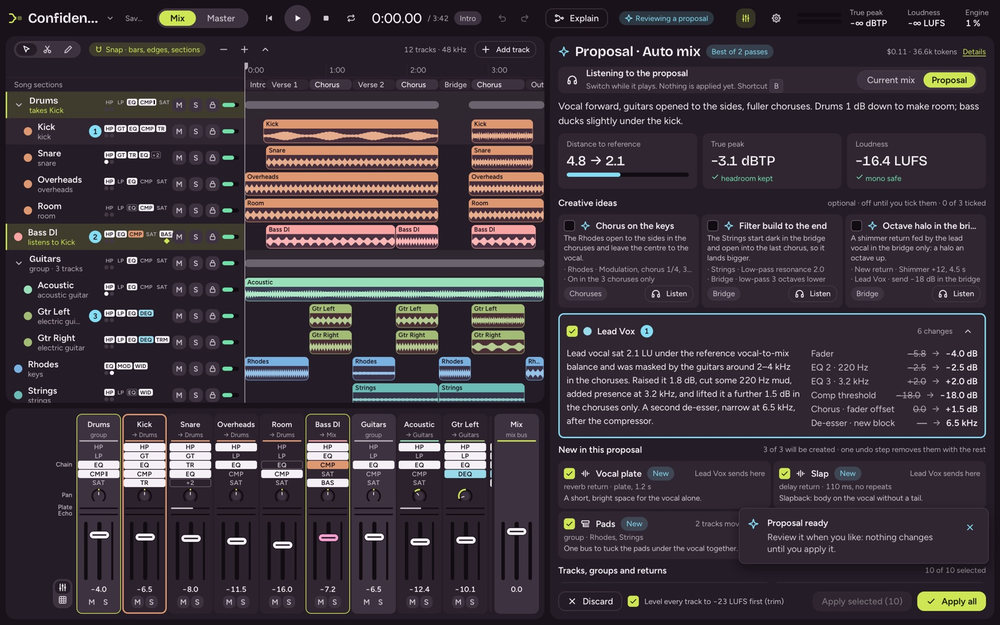
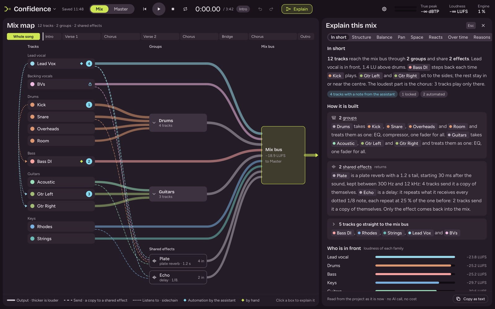
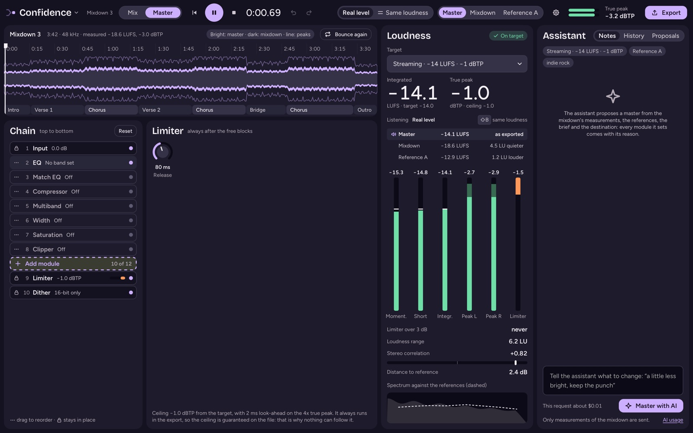
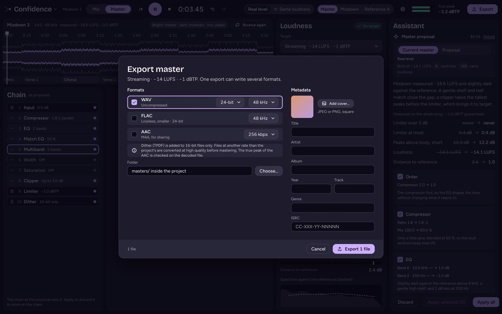

# Stemwise

**Mix and master the songs you recorded, with an assistant that proposes, explains and leaves the decisions to
you.**

[Website](https://stemwise.pierodetomi.dev) · [Download for macOS and Windows](https://github.com/pierodetomi/stemwise/releases/latest) · [Report a problem](https://github.com/pierodetomi/stemwise/issues)

Stemwise is a desktop app for macOS and Windows. You bring the stems of a song; it gives you a mixing desk, a mastering room
and an AI assistant that works the way a patient engineer would: it measures your tracks, proposes a mix, tells you
track by track what it changed and why, and waits for you to listen and decide. Nothing is applied until you say
so, and everything it does is one undo step away.

It is free and open source. It is meant for people who want to finish their own songs and understand how they got
there: beginners who need a guide, and people who already mix and want a second opinion they can read.

> [!NOTE]
> **Stemwise is an independent, non-commercial project.** One person builds and maintains it in his spare time,
> with no funding and no revenue from it. There is no support service and no guaranteed response time: issues and
> pull requests are read with care and answered as time allows, which may take a while. If you need it for work
> with a deadline, plan with that in mind.



## Contents

- [What it does](#what-it-does)
- [The assistant never hears your music](#the-assistant-never-hears-your-music)
- [Install](#install)
- [The assistant and what it costs](#the-assistant-and-what-it-costs)
- [What it does not do](#what-it-does-not-do)
- [Build from source](#build-from-source)
- [How the code is organised](#how-the-code-is-organised)
- [How it is tested](#how-it-is-tested)
- [How it was built](#how-it-was-built)
- [Contributing](#contributing)
- [Licence](#licence)
- [No warranty](#no-warranty)
- [Author](#author)

## What it does

### A mixing desk

- Import stems as WAV (also RF64), AIFF or FLAC. Files at another sample rate are converted on request. Your files
  are never modified.
- A timeline with clips, fades, song sections and automation of every continuous parameter.
- A mixer with nested groups, shared reverb and delay returns, and sidechain.
- A chain of blocks on every track, group and return, in any order: filters, EQ with a live spectrum, compressor,
  gate, de-esser, dynamic EQ, transient shaper, saturation, clipper, multiband, exciter, bass enhancer, width,
  chorus, flanger, phaser, tremolo, harmonizer and doubler.
- Four reverbs (plate, room, hall, shimmer) and three delays (stereo, ping-pong, tape).
- Unlimited undo, named snapshots, A/B comparison.

### An assistant that explains itself

Press **Auto mix**, or ask in words ("vocal a touch warmer in the verses"). The assistant measures every track,
drafts a mix, renders it, measures the result and corrects itself. Then it shows you a proposal:

- what changed on each track, with the old and the new value, and the reason in plain language;
- the groups and shared effects it wants to create;
- up to three creative ideas, kept apart from the rest, that you can listen to one at a time.

You compare the proposal with your current mix while the song plays, then apply all of it, only the tracks you
tick, or nothing. An applied proposal is a single undo step. You can lock the tracks you do not want touched.



### Explain this mix

A view that reads the project as it is and explains it without any AI: a map of where every track goes (groups,
shared effects, sidechains, the mix bus) and the same mix in words, for the whole song, for one track or for one
section. It is a way to learn what a mix is made of, starting from your own.



### A mastering room

Mixing and mastering are two separate phases. An explicit bounce freezes the mix; the master works on that.

- A free chain of modules: EQ, match EQ against your references, compressor, multiband, width, saturation, clipper,
  then a true-peak limiter and dither that always come last.
- Loudness targets (streaming, CD, your own), with integrated loudness and true peak measured on the whole song.
- A/B against the mixdown and against your reference tracks, at the real level or at the same loudness.
- **Master with AI**: the assistant proposes a chain, the app renders and measures it before showing it to you, and
  you apply it module by module.
- Export to WAV, FLAC and AAC in one go, with title, artist, album, year, ISRC and cover. The true-peak ceiling is
  checked on the files that were written.





### A guided tour

On first launch (and from **Help › Take the Tour**) a fifteen-step tour walks through the whole path on a
demonstration song that the app synthesises itself. It needs no account, no network and no files of yours.

## The assistant never hears your music

This is a design rule, not a setting.

- The model receives **numbers and words only**: loudness, spectrum, dynamics and masking measurements, the role
  and name of each track, your brief and your request.
- It never receives **audio**, **file names**, **paths** or the **title of the song**.
- All measuring, rendering and processing happens on your computer.
- What the model returns is the same kind of change you could make by hand, and it lands in the same undo history.

Every call is logged in **AI usage** inside the app, with the exact request that was sent and its cost, so you can
check this yourself.

## Install

Download the package for your system from the [releases page](https://github.com/pierodetomi/stemwise/releases).
Each release lists the SHA-256 checksums of its packages in `SHA256SUMS.txt`, if you want to verify the download.

**macOS** 13 or later, on a Mac with Apple Silicon:

1. Download the `.dmg`, open it and drag Stemwise to Applications.
2. The app is **not signed with an Apple Developer ID**, so macOS will refuse to open it the first time:
   - on macOS 15 or later, try to open it once, then go to **System Settings › Privacy & Security** and choose
     **Open Anyway**;
   - on macOS 13 and 14, right-click the app and choose **Open**.

**Windows** 10 or 11, 64-bit:

1. Download `Stemwise_<version>_x64-setup.exe` and run it. It installs for your user only, with no administrator
   rights. If WebView2 is missing, the installer downloads it.
2. The installer is **not signed**, so Windows SmartScreen may warn you: choose **More info › Run anyway**.

There is no account and no telemetry. Projects are folders on your disk (`Name.stemwise`).

## The assistant and what it costs

Stemwise itself is free. The assistant runs on AI models that you reach through **your own
[OpenRouter](https://openrouter.ai) account**.

- **Connecting.** The app guides you: it opens OpenRouter in your browser to authorise the connection, or you can
  paste a key. The key stays on your computer.
- **Cost.** What the models cost is set by OpenRouter and billed by OpenRouter to you. Stemwise shows an estimate
  before each request, lets you set a spending cap, and keeps the history of every call.
- **Without an account.** The desk, the master room, Explain this mix and the tour work in full. An "offline demo"
  mode lets you try the assistant's flow with a built-in stand-in that makes simple, fixed decisions.

Stemwise is an independent project. It is not affiliated with, endorsed by or sponsored by OpenRouter or any
provider of AI models, and its author earns nothing from what you spend there.

## What it does not do

Stemwise mixes and masters audio that already exists. By choice, version 1 has:

- no recording, no MIDI, no virtual instruments;
- no third-party plug-ins (AU, VST3, CLAP);
- no time-stretching or pitch correction;
- no MP3 export;
- no Linux build yet;
- an interface in English only.

Status: this is a first public version (0.1.x), made by one person. It is covered by a large automated test suite,
but it has been used on few real songs so far. Expect rough edges, keep backups of your projects, and please
[report what you find](https://github.com/pierodetomi/stemwise/issues).

## Build from source

You need stable [Rust](https://rustup.rs), Node 22 or later with [pnpm](https://pnpm.io), and
[`cargo-deny`](https://github.com/EmbarkStudios/cargo-deny) for the licence gate. On macOS (13 or later, Apple
Silicon): the Xcode Command Line Tools. On Windows (10 or 11, x64): the Visual Studio Build Tools with the C++
workload, and GNU make run from a bash shell such as Git Bash; `make build` there produces an NSIS installer.

```bash
git clone https://github.com/pierodetomi/stemwise.git
cd stemwise/app
make setup    # toolchain components, Rust and npm dependencies, the browser for the UI tests
make dev      # the app, in development
```

Other commands, all run from `app/`:

| Command | What it does |
| --- | --- |
| `make ui` | The interface alone in a browser, on a mock backend. No Rust build needed: the fastest way to work on the UI. |
| `make check` | The full gate: formatting, Clippy with warnings as errors, Rust tests, licences, types, ESLint, Vitest, Playwright, requirement coverage. It must pass before every commit. |
| `make test` | Only the tests. |
| `make bench` | The performance benchmarks, in release mode. |
| `make build` | `Stemwise.app` and the `.dmg`, in `target/release/bundle`. |
| `make schemas` | Regenerates the JSON Schemas and the TypeScript types from the Rust types. |
| `make third-party` | Regenerates the list of third-party licences that ships inside the app. |

There is also a command-line tool for trying the engine without the interface:

```bash
cargo run -p stemwise-cli -- --help    # demo project, import, analysis, auto mix with the stand-in, offline render
```

Development never needs an API key: the tests use a built-in stand-in for the model and a fake local server. No
test touches the network or a real audio device.

## How the code is organised

Stemwise is a [Tauri 2](https://tauri.app) app: an engine in Rust and an interface in React and TypeScript.

| Folder | What is in it |
| --- | --- |
| [`app/`](app/README.md) | The product. Everything below `crates/`, `src-tauri/` and `ui/` lives here. |
| `app/crates/stemwise-core` | The project document, commands with their inverse, undo histories, the project package, import. |
| `app/crates/stemwise-dsp` | The processors: filters, dynamics, saturation, reverbs, delays, limiter, loudness and true-peak meters. |
| `app/crates/stemwise-engine` | The audio graph, real-time playback and offline render (the same code), the master chain, the mixdown. |
| `app/crates/stemwise-analysis` | The measurements the assistant works from. |
| `app/crates/stemwise-ai` | The contracts of the plans, the prompts, the OpenRouter client, the verify-and-correct loop, the stand-in decider. |
| `app/crates/stemwise-export` | FLAC encoder, AAC through the system, WAV, tags, the export pipeline. |
| `app/crates/stemwise-cli` | The command-line tool. |
| `app/src-tauri` | The Tauri shell: session, commands, the threads of long jobs. |
| `app/ui` | The interface (React 19, Zustand), the mock backend, the Vitest and Playwright tests. |
| [`design/`](design/README.md) | The design system and the boards of every screen, as HTML. |
| [`docs/`](docs/FOUNDATION.md) | The specification and the project's log (see below). |
| [`poc/`](poc/README.md) | The Python proof of concept that came first. Frozen; kept as an archive and as a numeric oracle for the tests. |

A few rules shape the code, and a change that breaks one of them will not be merged:

- **The project document is the only source of truth.** The same project always renders to the same audio, bit
  for bit.
- **Nothing is destructive.** Imported files are immutable; every change is a command with its inverse.
- **The audio thread never allocates, locks or does I/O.** Playback and offline render run the same code.
- **The model never receives audio.** See above.
- **Permissive licences only** for anything that ships in the app. No GPL, LGPL or AGPL dependency.

## How it is tested

- **Rust tests** on synthetic signals with fixed seeds: numeric parity with the proof of concept, properties of
  commands and routing, no allocation in the audio callback, deterministic render.
- **Playwright** on the mock backend: the mix, assistant and master flows, error states, accessibility (axe-core),
  60 fps with 32 tracks, and a capture of every screen. The screenshots in this page come from those captures.
- **A self-test inside the packaged app**, with the real engine and the real audio device.
- Every test names the requirement it verifies, and `make check` fails if a requirement of the specification has no
  test.

What needs ears, a real model or a signature is listed, step by step, in
[docs/app/VALIDATION.md](docs/app/VALIDATION.md).

## How it was built

Stemwise was built by one person working with an AI coding agent
([Claude Code](https://claude.com/claude-code)), from a written specification. The repository keeps that process in
the open:

- [docs/FOUNDATION.md](docs/FOUNDATION.md): the specification, with every requirement numbered;
- [docs/app/DECISIONS.md](docs/app/DECISIONS.md): each decision taken along the way, with its alternatives and its
  reason;
- [docs/app/PROGRESS.md](docs/app/PROGRESS.md): the phases, and what is still unverified;
- [docs/app/dsp.md](docs/app/dsp.md): how each audio processor works and which properties are tested;
- [CLAUDE.md](CLAUDE.md): the rules the agent works under.

These documents are **in Italian**, the author's language: they are the project's working log, not user
documentation. Code, comments, commit messages and the interface are in English.

## Contributing

Bug reports, questions and ideas are welcome in the
[issues](https://github.com/pierodetomi/stemwise/issues), in English. If you plan a change larger than a fix,
open an issue first so we can agree on the direction before you spend time on it. Run `make check` before you open
a pull request. The details are in [CONTRIBUTING.md](CONTRIBUTING.md); security problems go through
[SECURITY.md](SECURITY.md), not a public issue.

Replies come as time allows: this is a spare-time project, as the note at the top says. A slow answer is not a
lack of interest.

## Licence

The code is released under the [MIT licence](LICENSE). Two exceptions:

- **The proof of concept in [`poc/`](poc/)** is under [GPL-3.0-or-later](poc/LICENSE), because it uses two GPL
  libraries. The app does not use the proof of concept or those libraries.
- **The Stemwise name and logo** are not covered by the MIT licence: all rights in them are reserved. A fork that
  is published needs its own name and icon. See [TRADEMARKS.md](TRADEMARKS.md).

The libraries that ship inside the app, with their licences, are listed in
[THIRD-PARTY-LICENSES.txt](app/src-tauri/resources/THIRD-PARTY-LICENSES.txt).

## No warranty

Stemwise is provided as is, without warranty of any kind, as the licence says. It may contain bugs, and the costs
it shows are estimates. To the extent the law allows, the author is not responsible for any damage or loss that
comes from using it, including lost work or charges from third-party services. Keep backups, and set a spending
limit on your OpenRouter account.

## Author

Made by Piero De Tomi, a software architect based in Trieste, Italy, who built it to get better at mixing and
mastering his own songs. More at [pierodetomi.dev](https://pierodetomi.dev).
